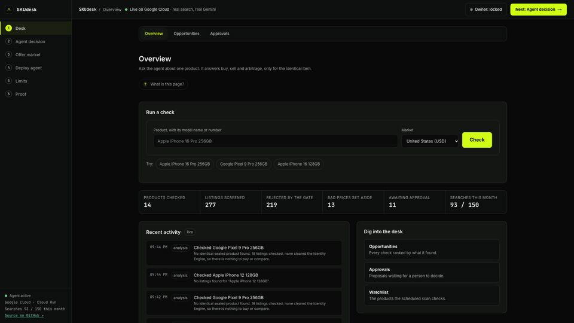
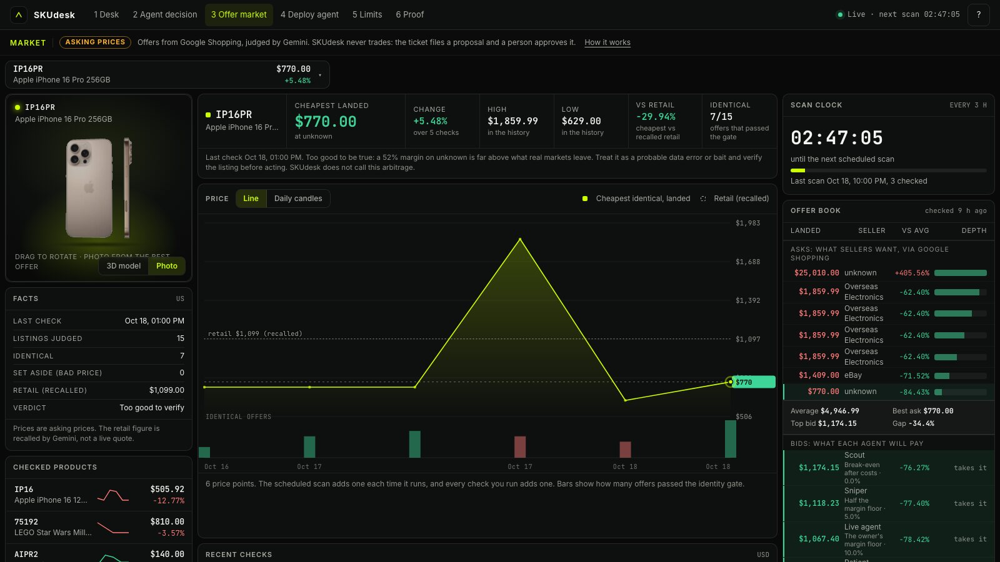
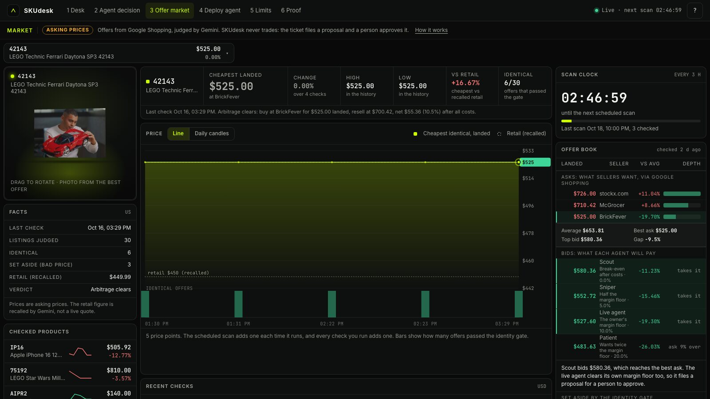
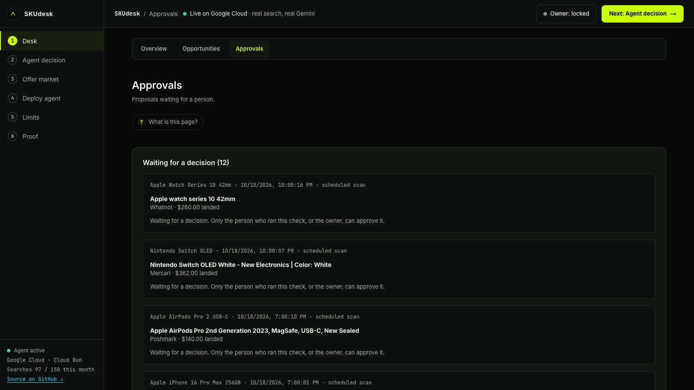
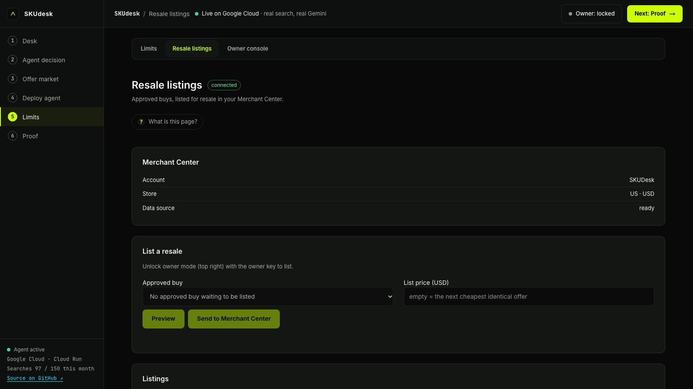
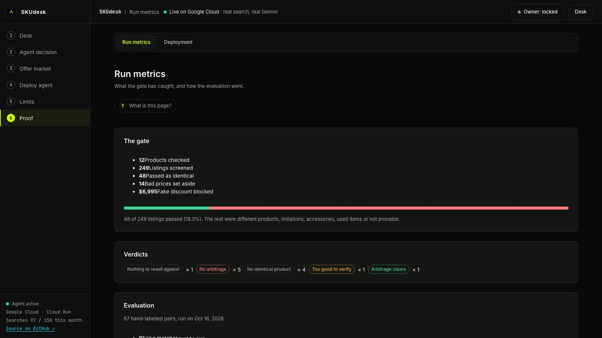
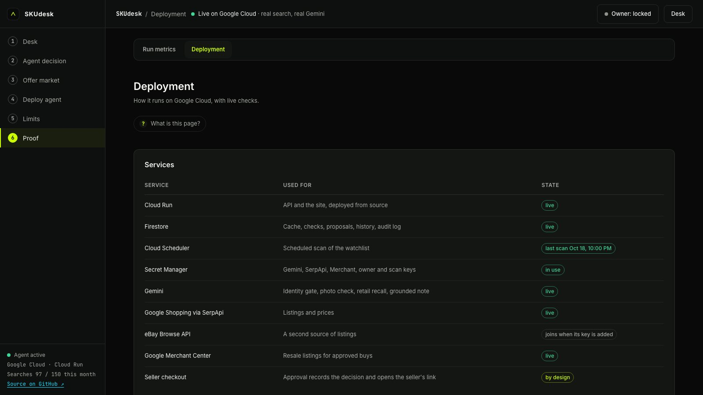
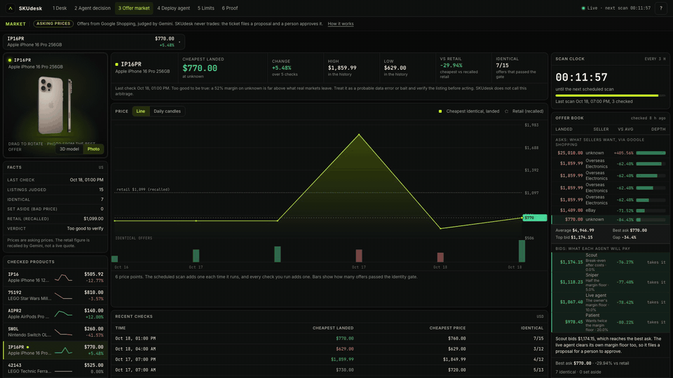
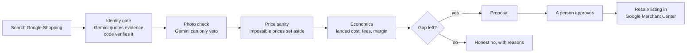
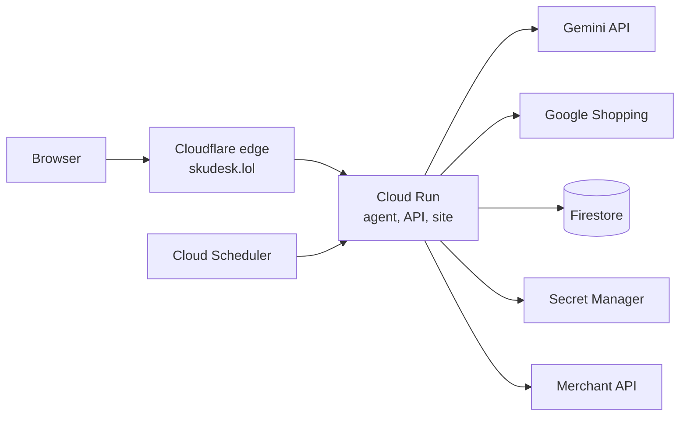

<div align="center">

# SKUdesk

**One price you can trust, only for the same item.**

An agent that finds the cheapest landed cost, prices a resale, and checks for arbitrage, only on identical products.

[](https://skudesk.lol)
[](https://youtu.be/DgpX9r0xt9Y)
[](https://skudesk-ij5vrivnta-as.a.run.app)
[](#how-a-check-works)
[](#resale-listings)



<sub>A live check on skudesk.lol. Green is the same product, red is something else.</sub>

</div>

## Why

A cheaper listing is only a deal if it is the same item. A different storage size, a Pro instead of the regular model, a case instead of a phone: each can look like a bargain. In our own checks about four in five search results for a product were not that product (201 of 249 listings screened on 18 Oct 2026).

So the agent settles one question first: is this the same item? Gemini decides, and has to quote the brand and model it relied on. Code checks the quotes are in the listing. If nothing matches, or no gap survives the costs, the answer is no. The agent never spends money: every buy is a proposal that a person approves.

Live at https://skudesk.lol, also on Cloud Run at https://skudesk-ij5vrivnta-as.a.run.app. Watch the [3-minute demo](https://youtu.be/DgpX9r0xt9Y).

## See it

<table>
<tr>
<td width="50%"><br><sub><b>Market.</b> Asks, the spread, four buyer policies' bids, history, and the product in 3D.</sub></td>
<td width="50%"><br><sub><b>Every product</b> has its own book, picked from a dropdown.</sub></td>
</tr>
<tr>
<td><br><sub><b>Approvals.</b> A person decides every buy.</sub></td>
<td><br><sub><b>Resale listings.</b> Preview, then send to Google Merchant Center.</sub></td>
</tr>
<tr>
<td><br><sub><b>Proof.</b> What the gate caught, and the labelled evaluation.</sub></td>
<td><br><sub><b>Deployment.</b> The Google Cloud services behind it.</sub></td>
</tr>
</table>

<p align="center"></p>

## How a check works



1. Search Google Shopping (an eBay adapter is ready for when a key is added).
2. Gemini compares each listing with the product you asked for and quotes the brand and model it used. Code confirms the quotes are in the listing text and reads the storage size and model tier (Pro against Pro Max) itself. A claim it cannot back up is "uncertain" and never passes. Listings the source labels pre-owned or refurbished are not sent to the gate.
3. Gemini then looks at the photo of each listing that passed, next to the product you asked for. It can only take a match away: a case, a box, another model or colour is dropped.
4. Offers priced far below the median, or below half the retail price Gemini recalls, are set aside as bad data.
5. Landed cost, fees, shipping and the margin floor are worked out in integer cents.
6. If there is a buy, the agent files a proposal. Only the person who ran the check, or the owner, can approve it.

Prices are asking prices from Google Shopping, not sold prices.

## Google services

| Service | What it does here |
|---|---|
| Gemini API (Google Gen AI SDK) | Identity verdicts with quoted evidence, the photo check, retail price recall, and a short note checked against the computed numbers |
| Google Shopping | Live listings and prices |
| Cloud Run | The agent, the API and the website (asia-southeast1) |
| Firestore | Checks, price history, proposals and the audit log |
| Cloud Scheduler | Scans the watchlist on a schedule, so each product builds a real price history |
| Secret Manager | API keys and the owner key |
| Merchant API | Previews and sends approved resales to a Merchant Center account |



## Layout

| Path | What it is |
|---|---|
| `src/` | The Node service: API, agent, identity gate, source adapters, storage |
| `web/` | The Astro site (landing, desk, opportunities, approvals, replay, market, watchlist, limits, resale listings, owner console, metrics, deployment) |
| `eval/` | 67 hand-labelled product pairs (phones, devices, LEGO sets, accessories) and the script that runs them against Gemini |
| `edge/` | The Cloudflare Worker in front of skudesk.lol |
| `deploy/` | Scripts for Cloud Run, Firestore, Scheduler and Secret Manager |
| `test/` | Unit tests, UI tests and a smoke test for a deployed URL |

## Run it

Node 22.18 or newer.

```
cp .env.example .env      # GEMINI_API_KEY, GEMINI_MODEL, SERPAPI_KEY
npm install
npm run web:build         # builds the site into web/dist
npm start                 # http://localhost:8080, data in .cache
npm test                  # unit tests
npm run e2e               # browser tests against a local server with stubbed sources
npm run eval              # runs the labelled pairs against the real Gemini API
npm run smoke -- <url>    # checks a deployed service end to end
./deploy/deploy.sh        # Cloud Run, Firestore, Scheduler, Secret Manager
```

## Owner mode

Anyone can run a check and read every page. Changing the agent needs the owner key: the per-buy limit, the margin floor, the kill switch, the watchlist and manual scans. The key lives in Secret Manager and is entered once per browser tab. Every change and decision goes to an audit log.

The kill switch stops scans, new proposals and approvals. A proposal above the per-buy limit cannot be approved.

## Market page

`/market/` shows one product at a time, picked from a dropdown. Everything on it comes from stored checks.

- **Asks** are the identical offers sellers want, dearest first, with the best ask next to the spread and each price shown against the average of the identical offers. Offers that matched the product but have a price nobody can believe are listed separately.
- **Bids** are what four buyer policies could pay. Each one is the live agent's cost model with a different margin floor (twice the owner's floor, the floor itself, half of it, break-even). A bid is the highest landed price that still clears its floor after fees, returns and postage when the item is resold at the next cheapest identical price.
- **A deal needs a bid at or above the best ask.** Most of the time none reaches it, because costs take about 15% of a resale. When one does, the page says which, and whether the live agent's own floor is cleared. A buy only ever becomes a proposal that a person approves.
- The chart is the history of the cheapest identical landed price, one point per check. The daily scan and every check run from the page add a point, so it fills in over days.
- Every watched product is a checked product with its own page. A product with a 3D model (phones, AirPods, Switch, MacBook, Watch, PS5) opens on the model and has a Photo button; the others show their best offer's photo with the background removed, and it turns in 3D too. A product the gate found nothing identical for shows what it turned down and why, and plots those listings by price. Products nobody has checked yet are listed separately and carry no price.
- The scheduled scan checks the watches that have waited longest (the number and the schedule are settings, `SCAN_MAX` and `SCAN_SCHEDULE`), so a longer watchlist (up to twelve) is covered in turn.

## Resale listings

After a person approves a buy, the owner can list the item for resale in their own Google Merchant Center account (Merchant API v1). Open `/app/listings/`, pick the approved buy, check the preview, and send it with the owner key. The listing is priced at the next cheapest identical offer and points to a product page on this site (`/p/<id>/`, with schema.org Product markup and its own picture route). Google's review result (approved, in review, or the issues it found) is read back into the page, and a listing can be removed from the same screen.

To connect an account, put the service-account key file path and the account id in `.env` and run `deploy/deploy.sh`:

```
GOOGLE_SA_FILE=/path/to/service-account.json
MERCHANT_ACCOUNT_ID=<numeric account id>
MERCHANT_DATA_SOURCE_ID=<numeric id, optional>
```

The service account is added as an Admin user in Merchant Center. If the data source id is left out, the page offers a button that finds or creates the API data source and shows its id. The key is stored in Secret Manager.

## Evaluation

`npm run eval` sends the 67 pairs to Gemini and reports the one number that has to be zero: a pair that should not match but passed the gate. The last run had none, and it missed no identical pair. 64 answers were exact; in the other three the model answered "uncertain" for a pair labelled different, which never reaches a buy. The pairs cover storage sizes, models and tiers, refurbished and carrier-locked phones, cases and bundles, clones, Thai-language titles, listings that try to steer the answer, and real titles captured live. Barcode pairs and more photo pairs are the next additions to the set.

## Buying

Approving a buy records the decision and opens the seller's link, and the person completes the purchase with the seller.
